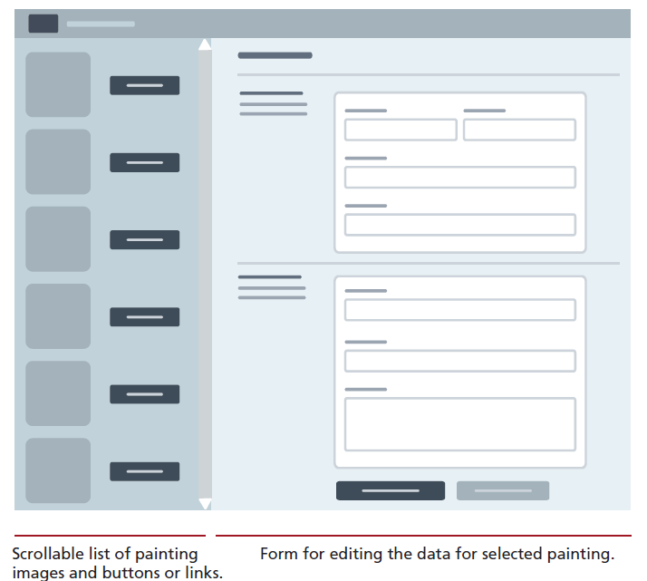

# InclassDatabaseActivity006
Atleast this time, i am not upoading a solution.
This is an in class activity for CSC 350, which covers inserting/updating and deleting content from a NoSQL database or a SQL.
- To be consistent, use the same styling for commit messages that was given in the Project.
    - [Prefix] – [Short description of the change]
      The following are the only possible options for [Prefix]:
    - FEAT - For new features or major additions to the project.
        - Example: `FEAT - Added contact form to the Contact page`
    - FIX - For bug fixes, corrections, or revisions to the code.
        - Example: `FIX - Corrected navigation bar alignment on mobile devices`
    - STYLE - For stylistic changes such as formatting, CSS modifications, or minor visual updates.
        - Example: `STYLE - Updated color scheme for better contrast`
    - DOCS - For changes or additions to the documentation, including README files and comments in the code.
        - Example: `DOCS - Added project description and setup instructions to README`
    - SECURITY - For changes related to improving the security of the website.
        - Example: `SECURITY - Implemented input validation for contact form`
    - REFACTOR - For code refactoring that doesn’t change functionality but improves code quality or organization.
        - Example: `REFACTOR - Organized CSS files and cleaned up redundant styles`
    - TEST - For adding tests or making changes to the testing suite.
        - Example: `TEST - Added validation tests for contact form input`

### Submitting your work
Once, you are sure that all the work is completed, go through the following steps for submission.
Upload your GIT repo link, if its private repo, make sure to send invite to the instructor.

# Project description
This project focuses on integrating database on the server side into a HTML application. The design of the HTML is open-ended with some bare requirements to be met, as mentioned below. Demonstrate your ability to both select and modify data into the database using Node and NoSQL. 

1. Implement a server/client architecture with a frontend and backend, both can be on localhost.
2. You are given a wireframe sketch of the supposed HTML page as seen in the picture below. You are free to implement whatever design you want as the focus here is on functionality. Your page must display a list of
   paintings; when the user selects a painting, it will display a form that allows the user to edit the data.
3. Once the submit button is presssed, the updated info should be stored in the database.

3. If using Node and NoSQL (MongoDB), then create a API that returns an array of all the paintings whenever needed by making a call to the database using the SELECT query.
   Add JavaScript to the HTML file that fetches the results from API and then populates the  left-side list with an image and a link styled as a button for each painting.
   Add click event handler for each link button, that displays the form on the
   right side each field in the form should be populated with the appropriate
   record data.
4. This table/data has many fields; you should break up the data-entry form into different sections to make it easier for the user. The form should have a button  for saving the current form values and a button for resetting the form. Be sure to set the action attribute of the `<form>`. This script will use form data passed to it, and construct and execute an UPDATE query (if using SQL) or use the findOneAndUpdate() method of the Mongoose model object.
4. Both SQL Tabular format and the NoSQL Json format are provided, it's your preference as to which one you want to go with on the database side.
5. Look up online resources to install SQL or MongoDB onto your machine. JSON file can be made to look prettier - https://jsonformatter.org/json-pretty-print
6. If a particular image file is not present, please use a default image as a template.
7. If you are using supabase and potsgresql, some minor syntax changes need to be done for the art-3rd.sql file.

## Tips and Suggestions
* Start small: Break this problem down into smaller steps. First verify the fetch works,
  perhaps with a simple `console.log` statement. Then populate the `<select>`
  lists based on the fetched data.
* You may decide to move your code into classes within your module after you
  finished your code, or you may decide to work with classes and modules right
  from the start.
* **DON’T USE ABSOLUTE PATHS**. Use only relative paths in your project files. This practice is particularly important when multiple people are working on the same project, as it ensures that links and references work correctly across different environments and systems.
* Iterate and Test: Continuously test your website after making necessary changes.
* Issues: Use the GitHub to create Issues and track the status of the issues using Milestones.
* Focus on Details: Pay attention to small details like spacing, hover effects, to create a polished final product.

## How to run
1. Requires Node.js 22.13 or newer (no `npm install` needed).
2. In the project folder, run `node server.js`.
3. Open http://localhost:3000 in your browser.
4. Click a painting on the left to edit it, then press Save.

